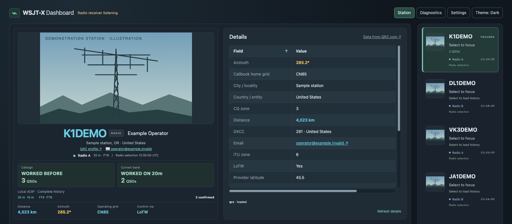
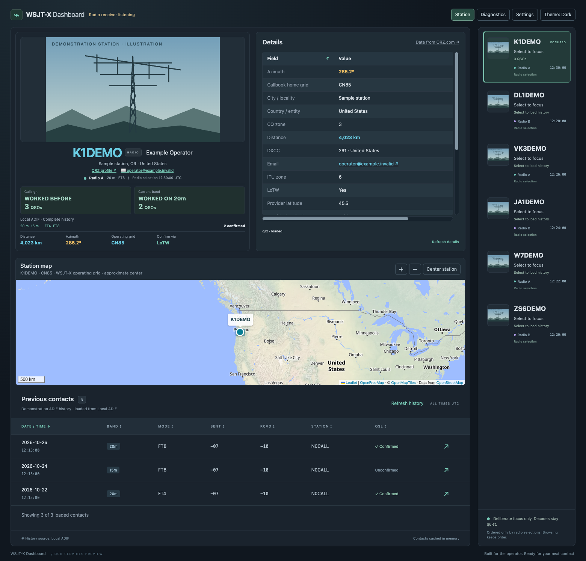

# WSJT-X Dashboard

*See who you're working. Know who you've worked. Log the contact automatically.*

[](docs/assets/dashboard-hero.png)

A self-hosted companion for WSJT-X: put the operator, previous contacts and station information beside your radio session. Run it on your station computer and open it in a browser. **Wavelog is optional.** Automatic logging and UDP forwarding are opt-in.

**Click a callsign in WSJT-X to focus the Dashboard on that station.** With UDP reporting connected, selecting a different station in WSJT-X immediately brings its callsign into focus; available operator details, photographs, map and worked-before information load automatically.



*The actual Station interface with fictional demonstration records and an illustrative antenna image. No operator credentials, personal photographs or live QSO records are shown. [View the full Dashboard screenshot at full resolution](docs/assets/dashboard.png).*

## Why WSJT-X Dashboard?

**Replace WaveLogGate's QSO logging function.** Dashboard submits completed contacts directly to Wavelog through API v2, with enrichment, automatic station-location matching when unambiguous, persistent delivery queues and duplicate protection. When Dashboard logging is enabled and correctly configured, a separate WaveLogGate uploader is no longer needed for those contacts. This replaces its QSO logging function, not every WaveLogGate capability.

**Reduce or eliminate “Update from Callbook”.** Dashboard enriches completed QSOs **before submission**, using QRZ, pyhamtools and calculated information. Available operator details, location, DXCC, grid, QSL routing, distance and other supported fields go into the original submission. Original WSJT-X values are preserved; enrichment depends on provider access and available data, so some contacts may still need manual updates.

| Workflow | WaveLogGate + manual callbook updates | Dashboard logging |
| --- | --- | --- |
| Send completed QSOs to Wavelog | Separate WaveLogGate uploader | Direct API v2 submission with a persistent queue and duplicate protection |
| Add station information | Use Wavelog's “Update from Callbook” afterward as needed | Include reliable, available enrichment before submission |

**Use one uploader per contact.** Disable competing WaveLogGate or downstream upload routes before enabling Dashboard's Wavelog logging to avoid duplicate QSOs. Dashboard does not disable other applications for you. [Logging setup and recovery](docs/logging.md).

**Proposed first pre-release: v0.9.0-beta.1.** The core application is implemented; beta preparation focuses on documentation and verification. macOS has been exercised on real station hardware. Ubuntu is a documented target, not yet execution-verified. Windows and Docker are not verified installation paths. [Readiness and limitations](docs/release-readiness.md).

## At the operating desk

- **Click to focus from WSJT-X.** Click a callsign in WSJT-X to select a different station and see available operator details, QRZ photographs, location and a zoomable map in the Dashboard. The callsign appears first; lookups follow without interrupting you.
- **Know your history.** Compact callsign and current-band indicators show whether you have worked the station. Browse previous QSOs, bands and modes. Failed or incomplete history never becomes a false “NEW”.
- **Revisit a contact.** Shared Focus History follows deliberate selections across multiple WSJT-X instances. Browse an older station without changing the radio.
- **Improve the record before logging.** Optional pyhamtools and QRZ enrichment fills reliable missing information, including QSL routing, contact details and calculated distance. Original WSJT-X values take priority, reducing later callbook-update work.
- **Choose your logbook.** Read Wavelog history, submit enriched contacts directly when configured, use a local ADIF file independently, or deliver to both. The Dashboard can replace WaveLogGate's logging role once you choose and validate a single upload path.
- **Feed other applications.** Configure independent, one-way UDP destinations for original WSJT-X packets or enriched Logged ADIF.
- **Keep delivery recoverable.** A persistent per-destination queue, saved receipts and reconciliation protect against repeated events and uncertain responses. This is duplicate protection, not a promise of exactly-once delivery across UDP and remote APIs.

The current-band indicator includes **all modes**; the mode overview and individual QSOs show what you worked. Focus follows changes to WSJT-X's reported DX Call, so selecting the same unchanged callsign again may not produce a new event.

## Start here

You need **Git, Python 3.12–3.14 and Node.js 24 LTS (24.15 or newer within 24.x), including npm**. A modern browser with WebGL displays the map. Providers and map tiles need internet access; QRZ XML requires suitable QRZ access.

```sh
git clone https://github.com/kf6ufo/wsjtx-dashboard.git
cd wsjtx-dashboard
./install.sh
.venv/bin/python -m backend.server
```

Open **http://127.0.0.1:8787/**. Keep the terminal open; Ctrl+C stops the server. The installer builds the frontend, creates configuration only if missing, and preserves existing settings/data. It does not install a background service or change WSJT-X. These commands install current `main`; the proposed beta tag does **not** exist yet. Repository access is required while the project remains private.

Next, open **Settings → Radio receiver**, match WSJT-X's UDP destination, and enable reception. For multicast, select this computer's receiving network interface. The first Status establishes a baseline; then click a different callsign in WSJT-X to focus the Dashboard on it. [Connect your first station](docs/quick-start.md).

## Use the combination that fits your station

| Setup | What you get |
| --- | --- |
| Dashboard + WSJT-X | Live station focus, shared selection history and diagnostics; add optional enrichment |
| Add an ADIF history file | Worked-before information without Wavelog; optional independent ADIF logging |
| Add read-only Wavelog | Authorized history and confirmations; no QSO submission required |
| Enable Wavelog logging | Enriched direct API v2 submission, automatic location matching and a durable queue |
| Enable ADIF and Wavelog logging | Independent delivery outcomes, without ADIF/Wavelog synchronization |
| Add UDP destinations | Feed compatible applications independently of permanent logging |

Start with reception and history. When enabling logging, ensure another uploader or forwarded destination will not also submit the same contacts. The Dashboard does not stop WaveLogGate or reconfigure other applications for you. [Logging setup and recovery](docs/logging.md).

## Documentation

[Documentation home](docs/README.md) · [Installation & updates](docs/installation.md) · [Quick start](docs/quick-start.md) · [Configuration](docs/configuration.md) · [Using the Dashboard](docs/using-dashboard.md) · [Logging & recovery](docs/logging.md) · [Troubleshooting](docs/troubleshooting.md) · [Architecture](docs/architecture.md)

[Changelog](CHANGELOG.md) · [Draft beta release notes](docs/releases/v0.9.0-beta.1.md) · [Readiness checklist](docs/release-readiness.md) · [QSO field audit](docs/qso-field-audit.md) · [Development checks](docs/development.md)

## Beta status

Real macOS operation includes multiple WSJT-X radios, QRZ/Wavelog reads and GridTracker2 reception. Enriched logging, recovery and field selection have extensive isolated automated coverage, but full isolated Wavelog write/outage acceptance and the new optional-field live export check remain outstanding. Ubuntu execution, Windows, Docker, MacLoggerDX integration and inline biography retrieval are unverified or deferred. [Evidence and limits](docs/release-readiness.md).

The server has no login system and binds to loopback by default. Keep it local, or use only a trusted network with appropriate access control. Credentials stay on the server; protect configuration, backups and logs. Never expose the Dashboard directly to the public internet.

Licensed under the [MIT License](LICENSE). WSJT-X, QRZ, Wavelog and other named applications are independent projects; their accounts, services and terms remain separate.
