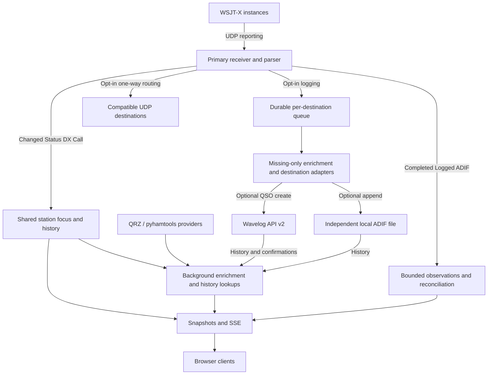

# Architecture

[Documentation](README.md) · [Development](development.md) · [Field mappings](qso-field-audit.md)

Dashboard is one Python server plus a built browser application. Vue 3, TypeScript and Bootstrap provide the frontend; FastAPI/uvicorn hosts APIs, server-sent events (SSE) and static assets. A native source build serves locally without an editor or frontend development server.

## Event and lookup boundaries

One server-owned IPv4 receiver parses notifications and keeps bounded diagnostics. Network IDs distinguish instances. Initial Status is a baseline; changed valid DX Call updates focus immediately. Ordinary decodes do not steal focus. Browser history navigation never sends radio commands.

Provider work runs asynchronously, with caches and a shared provider lock. Generation checks prevent stale results replacing a newer callsign. Each section distinguishes pending, empty, incomplete and failed results. Complete snapshots are pushed with SSE and fetched on reconnect; clients do not own independent station histories.

Completed-contact observation is separate from delivery. A bounded persistent observation can update worked status while awaiting read-only reconciliation, even when permanent logging is disabled. It is not a second permanent QSO logbook.

## Delivery and persistence

Configuration is TOML; credentials stay server-side. With the default configuration location, runtime files live in `data/`:

| Store | Purpose |
| --- | --- |
| `workspace.sqlite3` | Shared preferences, focus/history and public photo references |
| `delivery.sqlite3` | Pending QSO payloads, frozen targets, ADIF append journal and minimal delivery/dedupe receipts |
| `observations.sqlite3` | Bounded completed-contact observations, reconciliation receipts and history summaries |
| `forwarding.sqlite3` | Persistent completed-event forwarding dedupe receipts |
| `enrichment/` | Provider data/cache files as applicable |

Wavelog and the configured ADIF file are independent permanent destinations/history sources. There is no database write into Wavelog and no ADIF/Wavelog synchronization. Once all delivery destinations are terminal, outbox contact payloads are purged; receipts remain. SQLite schema versions reject incompatible state instead of overwriting it.

Forwarding has bounded independent destination queues. Original bytes stay unchanged; enriched completed records reuse preparation and valid WSJT-X framing. Sent counts are not acknowledgements. There are no reverse radio controls.

## Operational boundaries

The server defaults to loopback and has no authentication. Same-origin checks on browser writes are not a substitute for network access control. Internet services, QRZ account capabilities, UDP transport and receiving applications have their own failure modes. Native macOS is verified; Ubuntu, Windows and containers do not inherit that verification. [Readiness](release-readiness.md) records actual evidence.
