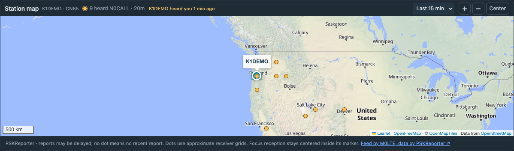

# Reception map and PSKReporter

Introduced in `v0.9.0-rc.1` (RC1). The operator accepted the visual preview on November 5, 2026 and approved publication to `main` for testing. Publication does not update or restart an operating installation.



*Earlier fictional reception-overlay capture: amber dots show receivers; the inner dot shows that the focused station heard the transmitting callsign. Current direction markers and ring colors are described below. [Screenshot provenance](assets/README.md).*

Enable **Settings → PSKReporter → Show recent reception reports**, choose a default window and save. Leave the transmitting callsign override blank to use the selected WSJT-X rig's station callsign. An explicit override supports installations without a reported identity. Existing configuration remains valid and the overlay defaults off.

The Station map defaults to **Heard me**: PSKReporter stations matching **your transmitting callsign and the focus entry's band**. All modes on that band count. Choose **I heard** for local WSJT-X Decode evidence from the focus entry's rig and operating callsign, or **Both** to combine them immediately in this browser. Reloading returns to Heard me. The time window applies to both sources. Neither the selector nor local decode evidence changes QSO Outlook scoring.

| Evidence | Shape | Color |
| --- | --- | --- |
| Heard me | Circle | Amber `#F0A12B` |
| I heard | Square | Blue `#3478D4` |
| Mutual reception | Split circle | Blue left / amber right |

Mutual means that the **same complete callsign and band**, for the same operating identity, have qualifying reports in both directions inside the selected window. Sharing a grid is insufficient. Portable identities and suffixed PSKReporter receiver identifiers remain separate. A mutual station has one combined marker and a tooltip with both reports, their ages, UTC timestamps and available signal reports. Changing views filters station inclusion; a mutual station keeps its split appearance even in a single-direction view.

The focus keeps its larger teal marker and contrasting outline in every view. Its inner marker independently shows amber, blue or split evidence, or stays neutral if no qualifying report exists. It stays centered at the focus location even when a report's grid is coarser/different. Focus evidence remains visible across filters. Other markers use reported grid centers; positions are approximate. Hover or keyboard-focus an ordinary marker for sender/receiver, band, mode, SNR, age and available source details. The map never sends radio commands.

Receiver locators accept 4, 6, 8 or 10 characters, case-insensitively. For example, `EN34qb49ta` uses the common 10-character extension described in the [IARU Region 1 VHF handbook](https://vienna.iaru-r1.org/wp-content/uploads/2019/01/VHF_Handbook_V8.02a.pdf): the fifth pair is A–X, subdividing the eight-character cell 24 ways on each axis. The map uses the complete locator's cell center and bounds. Odd-length locators, invalid character ranges and locators longer than ten characters are rejected. This reception/map support does not change logging-field validation.

Receiver identifiers can include hyphenated numeric or text suffixes, such as `N9HXR-888`, `N3AGE-0` or `K1FOCUS-RX`. [PSKReporter's own receiver statistics](https://pskreporter.info/cgi-bin/pskstats.pl/1000) include suffixed identifiers. Dashboard accepts its usual base callsign (including portable `/` components) followed by alphanumeric suffix components separated by hyphens, up to 32 characters in total. Identifiers are normalized to uppercase with surrounding spaces removed; empty components, control characters, non-ASCII text and other punctuation are rejected. The complete receiver identifier is retained in Diagnostics, map labels and cache/deduplication keys. A suffixed receiver stays separate from its base callsign and does not automatically light that base station's inner “heard you” dot. Transmitting callsign matching, station settings, WSJT-X selection and QSO validation keep their existing rules.

Choose **Last 5, 15, 30 or 60 min** above the map. This applies immediately to that browser without an upstream request; Settings saves the shared default. The initial default is 15 minutes. New reports preserve map pan/zoom. Use **Center** to return to the focus, or zoom out to see receivers farther away. The compact toolbar keeps the station/grid, reception count, time window and map controls together. Hover the station/grid for full location-source details; connection or missing-data explanations appear below the toolbar when needed. The overlay never selects a station, changes Focus History or sends commands to WSJT-X.

Reports are collected while the server runs. There is no historical backfill, XML polling or query per focus request. An empty map means no matching recent reports have been collected, not that nobody can hear you. PSKReporter uploads may be delayed; this is recent reception evidence, not instantaneous radio telemetry. Feed errors and Dashboard disconnects are shown independently of available cached dots. Dots continue to expire during outages.

One backend TLS MQTT connection subscribes to `pskr/filter/v2/+/+/{transmitting-callsign}/#` for each detected WSJT-X station identity, or just the explicit override. There is no global feed subscription and no subscription based on the focused remote callsign. A new selection captures its local station callsign; older history entries fall back to the same rig's current reported identity. Telemetry is rediscovered after a server restart, so automatic mode waits for WSJT-X Status. Portable callsigns remain exact identities; base-call matching is not inferred.

The volatile cache keeps the latest report per sender/band/receiver for one hour, bounded to 10,000 entries. Overflow evicts the oldest report and is indicated on the map. A bounded 512-message network-thread queue is drained/coalesced every two seconds; like MQTT QoS 0, it is best effort under overload. Only the shared focus identity/band’s last hour is included in browser snapshots; changing focus filters the backend cache without resubscribing. Browser expiry is checked every ten seconds. Restart clears reception reports; it preserves operator configuration, history, contact logs, observations, queues and receipts. No QSO logging or forwarding routes are changed.

The implementation follows the [feed operator's endpoints, topic layout and JSON schema](https://www.mqtt.pskreporter.info/) and [timestamp guidance](https://www.mqtt.pskreporter.info/timing.html): frequency determines band, `t_tx` takes precedence over `t`, and old, malformed, wrong-sender or invalid-grid reports are rejected. TLS certificate verification stays enabled on `mqtt.pskreporter.info:1884`. Paho MQTT 2.1.0 is pinned in `requirements.lock`; [Paho's client documentation](https://eclipse.dev/paho/files/paho.mqtt.python/html/client.html) describes connection/reconnect behavior. Only subscribe/unsubscribe and connection-control traffic is sent; no spots are published.

## Local decode evidence and limits

The existing receive-only WSJT-X pipeline supplies local evidence. A bounded **2,000-entry, one-hour in-memory cache** retains the latest reception per rig network ID / local station callsign / band / remote callsign. Only the selected focus rig/identity/band is sent through existing browser snapshots. No new API endpoint, service, dependency, subscription, database table or backfill is added. Restart clears this cache. Clear/Close messages remove that rig's local reception evidence; a receiver restart requires fresh Status before accepting new decodes. Clearing Diagnostics or managing Focus History does not remove cache evidence or change logs/queues.

A new live, high-confidence Decode needs a recent Status (within 90 seconds) identifying its station callsign and band; the operating mode comes from that Status. Explicit playback/off-air, low-confidence and replay reports are excluded. Legacy Decode packets without both flags remain available to the existing diagnostics/forwarding path but do not prove map reception. Decode UTC time is resolved across midnight; evidence more than one hour old, over 30 seconds in the future or predating a new band/identity/mode context by more than 30 seconds is excluded.

Only unambiguous standard CQ/QRZ and two-call grid/report/acknowledgement messages are understood. Free text, unresolved hashed calls and compound/unsupported message forms are skipped. `RR73` acknowledgements are not treated as grid locators. Use a valid reported 4/6/8/10-character grid from the Decode, current matching WSJT-X DX grid, an earlier grid-bearing decode or an exact same-rig/identity/band selection from the last hour. A carried grid expires independently of subsequent no-grid reports. Stations without a usable grid are omitted; locations are never invented or borrowed from an unrelated callsign, band, rig or grid neighbor.

Local evidence follows the actual WSJT-X station identity. If a PSKReporter override differs from that identity, local rows are omitted rather than combined across callsigns. A no-grid/unsupported message, missing Status, cache overflow, reception outage or no recent matching report can leave the map empty without establishing poor propagation. These are recent observations, not an exhaustive reception record. The parser follows the append-only [official WSJT-X Decode protocol](https://github.com/WSJTX/wsjtx/blob/master/Network/NetworkMessage.hpp); original UDP forwarding bytes and focus-selection rules are preserved.

## Experimental QSO Outlook ring — Version 1

The focused station's teal marker has an outer ring: **green `#20A66A` — Favorable (70–100)**, **gold `#E1BC3B` — Moderate (40–69)**, **muted red `#C46C74` — Limited evidence (1–39)** or **gray `#8995A3` — Unknown**. This is a deterministic heuristic using the existing volatile reception cache, **not a statistically calibrated probability**. A missing report never means that a station cannot hear you.

Click the focused marker (including its reception center), or focus it and press **Enter** or **Space**, to toggle its compact QSO Outlook popup. Click the marker again to close it, or use **X** or **Escape**. It shows callsign/band/mode, score/classification, direct confirmation, distinct receiver counts within 200/500 km, nearest qualifying receiver, latest qualifying report age and an explanation. The 500 km count includes receivers within 200 km. The popup shows a concise reception summary (Mutual reception, Heard me, I heard or No recent evidence) and distinguishes the selected map display window from the capped Outlook/nearby evaluation windows. Its height is bounded to the measured map canvas; the title/close button remain visible while the evidence body scrolls internally. Map tooltips are hidden while it is open to avoid overlap; opening or closing it does not pan or zoom. Closing returns keyboard focus to the marker. A focus/location change closes the old popup.

Only the selected **transmitting callsign and focus band's** reports count. Direct evidence uses the exact focused receiver identifier, retaining the distinction between a base callsign and a suffixed receiver. Direct evidence always takes priority, even in another mode on that band. For nearby evidence, prefer receivers reporting the focus entry's operating mode when any qualifying receivers in that mode exist within 500 km; otherwise fall back to all modes on the band. The popup labels the nearby mode scope. Only the latest cached report per complete receiver identifier is available; earlier reports/modes are not recovered or stored.

Rules are applied in this order:

| Evidence | Score |
| --- | --- |
| Focused station directly heard you no more than 5 minutes ago | 90 |
| Direct reception more than 5, up to 15 minutes ago | 80 |
| At least 3 distinct receivers within 200 km in the last 10 minutes | 75 |
| 1–2 receivers within 200 km in the last 10 minutes | 60 |
| At least 3 receivers within 500 km in the last 10 minutes | 55 |
| 1–2 receivers within 500 km in the last 10 minutes | 35 |
| No qualifying evidence | Unknown |

All scoring evidence must also fit the browser's selected reception window. A 5-minute window therefore limits both direct and nearby evidence to 5 minutes; 30/60-minute windows do not extend the scoring caps of 15/10 minutes. Ages use report timestamps with the existing feed's 30-second future-clock tolerance. Receiver grid centers and the existing station grid/callbook location determine great-circle distances. Country/entity estimates cannot establish a station position, so they give Unknown. PSKReporter off, missing band/transmitting identity, an unavailable location or no usable cached evidence also give Unknown. Recent usable cached reports can continue to support an outlook during a feed or Dashboard outage, expiring on the existing ten-second browser timer; connection warnings remain visible independently.

The **amber center or amber half of a mutual marker** and **Heard you: Confirmed** remain separate evidence that the exact station reported your signal, across all modes in the selected overlay window. A 20-minute-old direct report can still show confirmation in a 30/60-minute overlay while QSO Outlook is Unknown; the popup labels “Last heard you” as outside the 15-minute Outlook window. Expiry is not evidence of poor propagation. Confirmed reception does **not** guarantee a QSO. Outlook does not account for antenna differences, interference, pileups or operator availability. Callbook/home locations and coarse receiver grids can differ from actual operating positions; receiver identifiers need not represent independent antennas.

The calculation runs entirely in the browser and refreshes with focus/location, transmitting identity, band/mode, reports, time window and report age. It uses no WSJT-X received SNR, CQ status, Wavelog history, new API, subscription, database, machine learning or historical collection. No new Settings control is needed. Version remains `0.9.0-rc.1`; source publication for testing does not update/restart an operating installation.

## Diagnostics

Open **Diagnostics → UDP / PSKReporter MQTT**. The operator approved this follow-up for publication to `main` on November 6, 2026; the version remains `0.9.0-rc.1`. Update and restart your installation through the normal workflow to get the new tabs. Publication itself does not change an operating installation or enable PSKReporter.

The MQTT tab explains whether the overlay is disabled, waiting for a transmitting callsign, connecting, subscribed without traffic, rejecting reports, or holding reports that do not match the focus band/window. Start here when reception dots are missing:

1. If **disabled**, enable the overlay in **Settings → PSKReporter** and save. Automatic mode waits for WSJT-X Status to report your station callsign.
2. Check the monitored transmitting callsign and the broker's subscription **acknowledgement**. A TCP/MQTT connection alone does not establish that a subscription was accepted.
3. Compare **MQTT messages**, **accepted reports**, rejections/duplicates and the last-message timestamp. Read the recent report results and connection events for reasons.
4. Compare **cached receivers by band** with the **focus band's** transmitting identity and saved time window. Different rigs can be operating on different bands; a 10m report does not appear for a 12m focus. The Station map's per-browser window can differ from the saved default shown in Diagnostics.

Counters cover the current server session; queued messages may not yet be processed. Accepted reports count new/latest receiver updates; cached totals count distinct sender/band/receiver combinations within the last hour. Duplicate/older reports do not replace a newer cached report. Oversized payloads and queue overflow are counted even when no message row can be retained.

Filter the recent-report table with **Sender → receiver**, **Band / mode** and **Result**. The two search boxes match partial text without regard to case; each space-separated term must occur in that column. For example, `N0CALL K2NEAR-888` matches both callsigns, and `20m FT4` matches that band and mode together. Rejected reports without a resolved band can be searched by their displayed frequency or `Unknown`. Result selects all, accepted, rejected or duplicate/older reports. All three filters apply together; **Showing … of … retained messages** reports the matching count, and **Reset filters** restores the full retained list. Filters stay local to the browser's Diagnostics view, survive polling and UDP/MQTT tab switches, and work while display is paused. They do not filter collection, session counters, connection activity or Station map reports.

The tab keeps 100 allowlisted report summaries and 50 connection events in server memory. It records public radio fields and rejection reasons without saving raw MQTT payloads or arbitrary JSON fields. **Clear MQTT diagnostic rows** removes these lists only; counters, cache, focus/history, contact data and delivery work remain intact. **Pause MQTT display** freezes this browser's diagnostic response while collection continues. Only the visible tab polls local Dashboard endpoints; these polls do not make upstream PSKReporter queries. Failed diagnostic requests show the last successful response as stale rather than replacing its counters with zero.

Read-only interfaces are `GET /api/pskreporter/diagnostics` and `GET /api/diagnostics` (UDP). Their corresponding DELETE actions clear only the selected interface's diagnostic rows and retain the existing same-origin restriction. MQTT diagnostics are separate from browser SSE snapshots so recent diagnostic lists do not enlarge ordinary map/telemetry updates.

## Isolated visual preview

With dependencies installed and the frontend built, run:

```sh
npm run build
.venv/bin/python scripts/preview-pskreporter.py
```

Open **http://127.0.0.1:8798/**. The title explicitly says fictional reports. Choose Both to see fictional local blue squares and mutual split circles alongside PSKReporter reports. The preview uses temporary configuration/state, disables radio reception and logging, and replaces MQTT with an offline fixture feed. It does not read the operating configuration or contact files. Basemap tiles still need internet access. Ctrl+C stops it and removes its temporary state. Use `--port` to choose another isolated port; 8787 is excluded.

## QSO Outlook validation — November 8, 2026

Application source `0ccbca5`, based on main `e2b721b`: 81 frontend tests (including 21 new outlook cases), type checking/production build, seven production-build Chrome fixture workflows and the MQTT Diagnostics workflow passed on macOS. Checks include all score tiers, report ages/windows, unique/suffixed receiver identities, band/transmitter/mode matching, location safety, outages, focus changes, popup keyboard access, live expiry, independent confirmation, narrow layout, reception dots and preserved map pan/zoom. Fictional desktop dark/mobile light captures were visually reviewed. A clean source export passed the native installer and isolated installed-server startup/configuration-preservation/shutdown checks. The backend is unchanged; its full suite was not rerun. Ordinary live station alignment and outlook behavior, Ubuntu and other browsers still need testing. No operating installation was updated or restarted. See [the checkpoint](current-checkpoint.md) for exact evidence and remaining limits.

## Evidence — November 5, 2026

- macOS, Python 3.13.1, Node 24.21.0: 252 backend tests passed at RC1 application source `04c6644` in an isolated source copy with pinned dependencies. The 17 PSKReporter cases cover schema validation, report direction, exact identity, time/frequency handling, cache bounds/deduplication, expiry, identity changes, reconnect/resubscribe, refusal retry delay, settings validation and unrelated configuration preservation.
- 38 frontend tests passed; type checking and the production build passed. Existing large MapLibre bundle and Starlette/httpx deprecation notices remain.
- The offline Chrome overlay workflow verifies smaller reception dots, exact inner-dot centering, time-window changes, expiry, band/identity changes, pan preservation, Settings access and narrow light-theme layout. Screenshots are fictional. All eight RC1 Chrome browser workflows passed (six demo/fullscreen/reception plus installed workspace and loopback receiver). A separate production-build fixture-server check verified matching dots and shared saved settings in two browser clients, with no page errors. Actual basemap tiles and fictional reception dots were captured and visually reviewed.
- A separate 45-second receive-only subscription for the operator's callsign connected to the **actual TLS broker** and subscribed successfully. It received **zero reports** during that interval. This establishes connection/subscription only; actual ordinary station report ingestion and alignment with an operating focus still need operator testing.
- Ubuntu execution, other browsers and an extended outage/recovery against the real broker have not been separately exercised for this feature. The operating Dashboard installation has not been updated or restarted.
